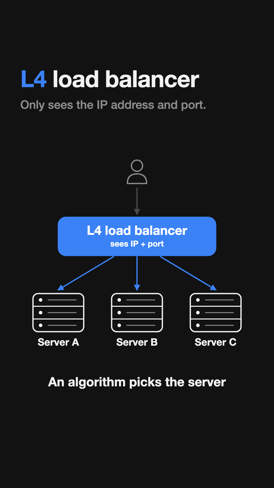
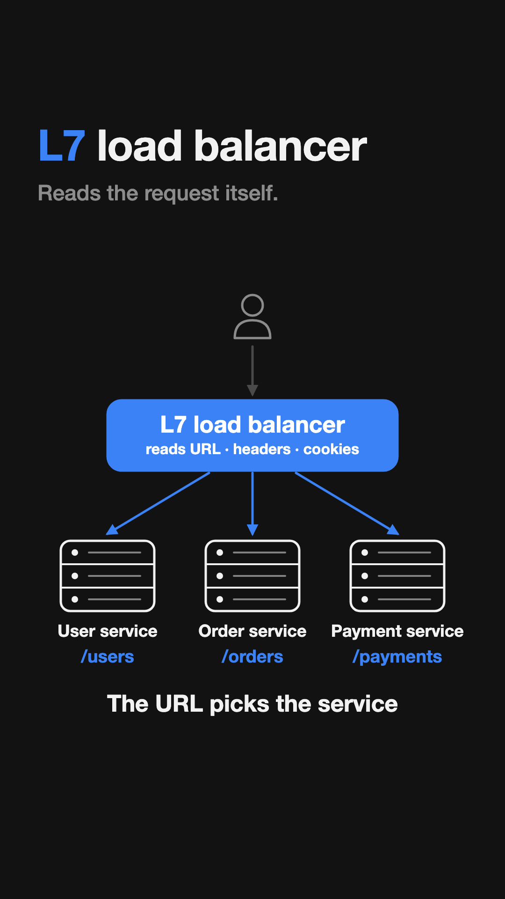
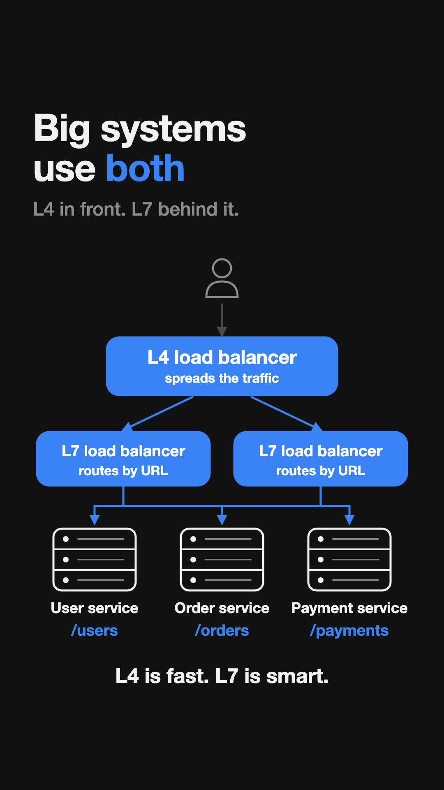

# L4 vs L7 Load Balancer — Explained Simply

A common system design interview question: **what's the difference between an L4 and an L7 load balancer?**

The short answer: **it's about how much of the request the load balancer looks at.**

---

## 1. L4 load balancer: sees only the IP address and port

Every request carries an **IP address** (where it's going) and a **port** (which door on that machine, like `443` for websites).

An L4 load balancer **only sees these two things**. It never reads what the user actually asked for.

It uses the IP and port with an **algorithm** (a simple rule, like taking turns) to decide which server gets the request.

**Good at:** being very fast, because there's so little to read.
**Can't do:** tell the difference between "show my orders" and "make a payment". To L4, every request looks the same.

---

## 2. L7 load balancer: reads the request itself

An L7 load balancer **opens the request and reads it**: the **URL**, the **headers**, and the **cookies**.

That lets it make smart choices. A common example is **microservices**, where an app is split into small separate services:

| Request URL  | Goes to          |
|--------------|------------------|
| `/users`     | User service     |
| `/orders`    | Order service    |
| `/payments`  | Payment service  |

So if you open your orders page, the L7 load balancer sees `/orders` in the URL and sends you to the **Order service**.

**Good at:** smart routing.
**Trade-off:** a bit slower than L4, because it has to read every request.

---

## 3. Big systems use both

In production, the two are often combined:

1. The user's request first reaches the **L4 load balancer**.
2. L4 is fast, so it **spreads the traffic** across several L7 load balancers. One L7 alone couldn't handle all of it.
3. Each **L7 load balancer reads the URL** and sends the request to the right microservice.

> **L4 is fast. L7 is smart.** Together you get speed *and* smart routing.

---

## Side by side

|                       | L4                         | L7                                  |
|-----------------------|----------------------------|-------------------------------------|
| Looks at              | IP address + port          | URL, headers, cookies               |
| Speed                 | Very fast                  | A bit slower                        |
| Can route by URL?     | ❌ No                      | ✅ Yes                              |
| Typical use           | Spreading huge traffic     | Microservices, websites, APIs       |
| Real examples         | AWS NLB                    | AWS ALB, Nginx                      |

---

## Quick recap

- A **load balancer** decides which server handles each request.
- **L4** only sees the **IP address and port**, so it's fast but can't tell requests apart.
- **L7** reads the **URL, headers and cookies**, so it can send each request to the right service.
- **Big systems use both:** L4 in front for speed, L7 behind it for smart routing.

**One line for your interview:**
> *"L4 sees the address. L7 reads the request."*

---

## Why "L4" and "L7"?

The names come from the **OSI model**, a standard way of splitting networking into 7 layers.
- **Layer 4** is the *transport* layer, where ports live. An L4 load balancer sees this layer and the IP address from the layer below it.
- **Layer 7** is the *application* layer: the actual request, like URLs and cookies.

You don't need to memorise all 7 layers. Just remember: **higher layer = sees more of the request.**

---

*Made for students learning system design from my Instagram reel. If this helped, share it with a friend!*
